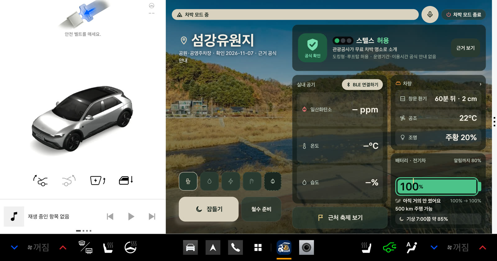
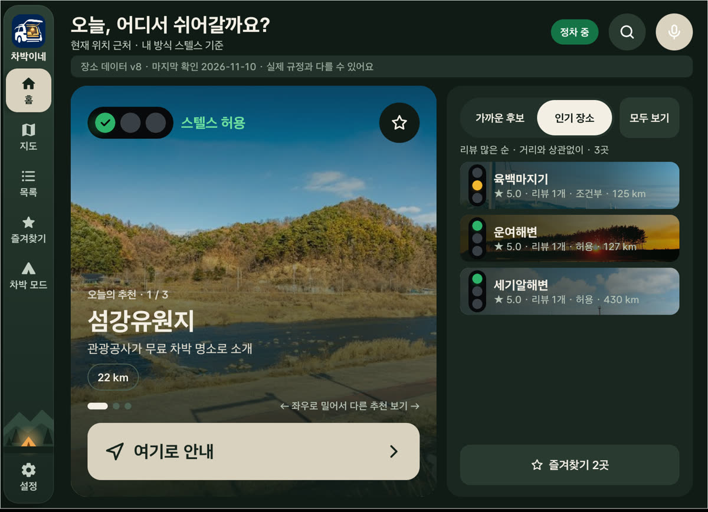
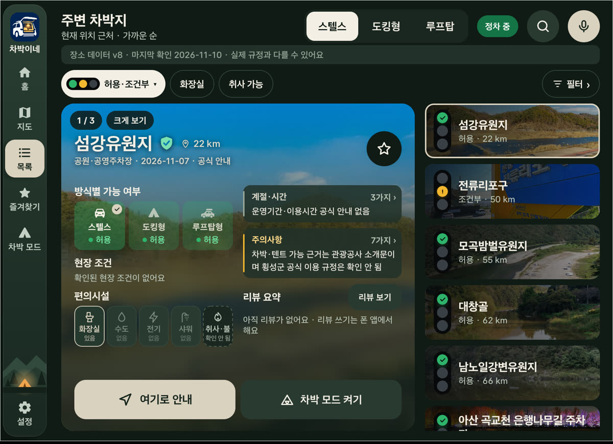
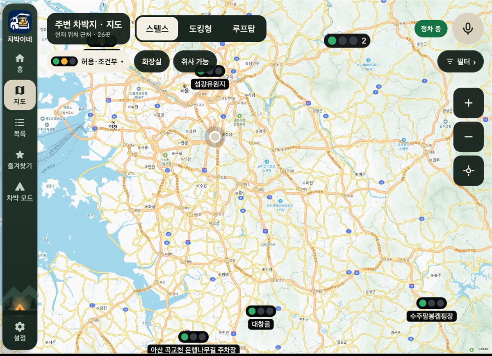
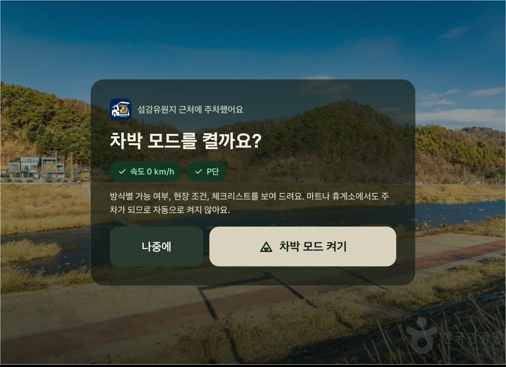
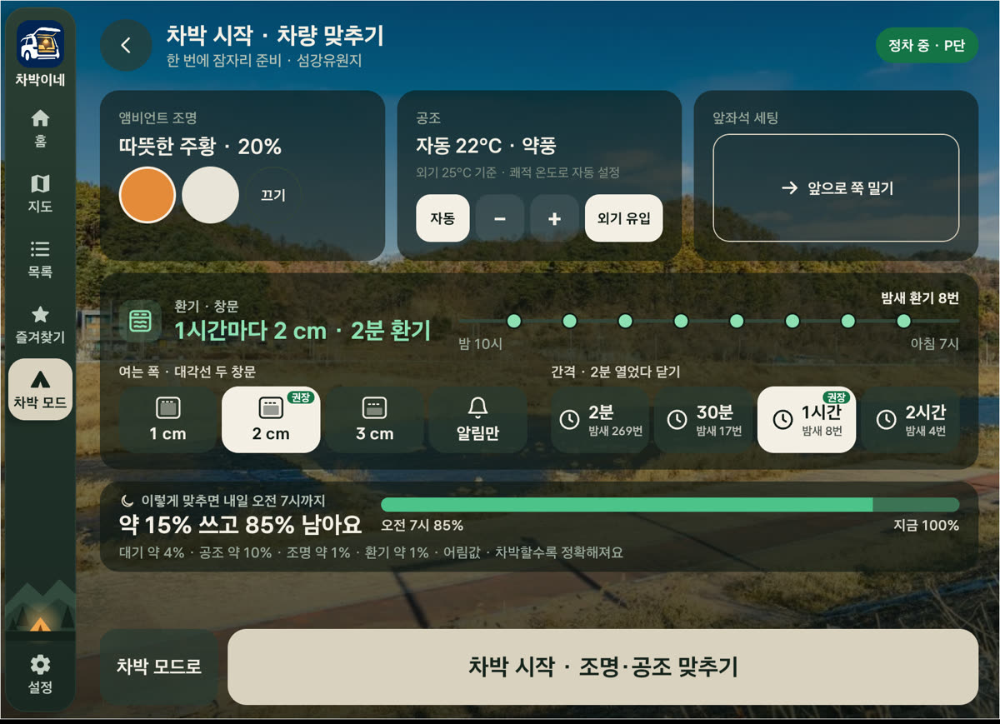
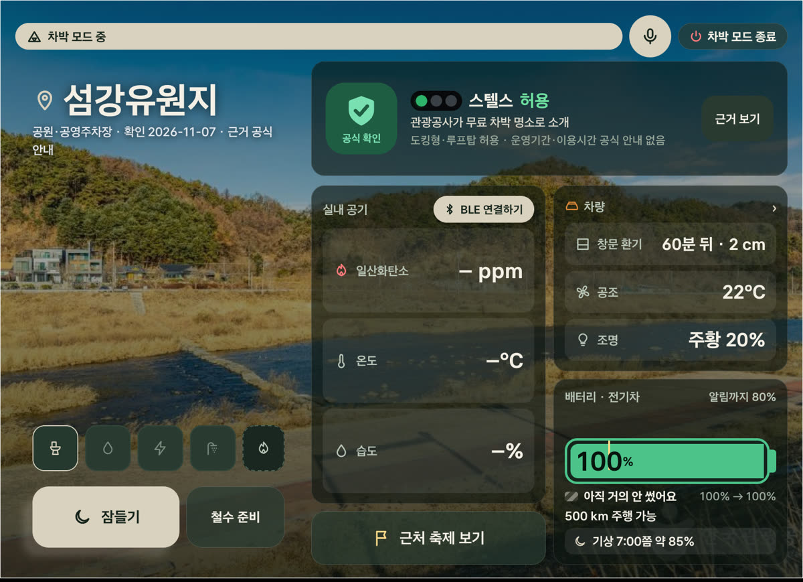

<div align="center">


# 차박이네 for Pleos

**달릴 때는 오늘 밤 차박할 곳을 찾아 주고, 멈추면 차박 준비를 도와주는 차량용 앱**

Pleos(Android Automotive OS) 차 화면에서 동작해요. 장소마다 차박 방식별로 허용 · 조건부 · 금지를 신호등으로 보여 주고, 근거와 확인 날짜를 함께 보여 줘요.


[](https://youtu.be/YCJdY6dm7XY?si=UgaLs-u7-oWntgC_)
[](apk/Sanho_%EC%B0%A8%EB%B0%95%EC%9D%B4%EB%84%A4_release.apk)



</div>

---

## 소개 영상

<a href="https://youtu.be/YCJdY6dm7XY?si=UgaLs-u7-oWntgC_"></a>

<sub>▶ 이미지를 누르면 YouTube에서 열려요 · [차박이네 for Pleos | 달릴 때와 멈출 때를 아는 차박 앱](https://youtu.be/YCJdY6dm7XY?si=UgaLs-u7-oWntgC_)</sub>

## 왜 만들었나

차박할 곳은 보통 차 안에서 정해요. 그런데 운전 중에는 폰을 만질 수 없어요. 그리고 "여기서 자도 되나?"는 블로그 후기, 지도 앱 리뷰, 캠핑장 예약 앱에 흩어져 있어서 확인하기 어려워요.

차박이네는 그 답을 **차 화면 하나에서 신호등으로** 보여 줘요. 고른 곳은 Pleos 내비로 바로 안내해요. 도착해서 차를 세우면 같은 앱이 차박 모드로 이어져요.

| 🚗 달릴 때 · 찾기 모드 | 🌙 멈췄을 때 · 차박 모드 |
|---|---|
| 지금 위치 주변 후보를 신호등, 이유 한 줄, 거리로 크게 보여 줘요 | 차박지 근처에 차를 세우면 "차박 모드를 켤까요?"라고 화면과 소리로 물어요. "켜 줘" · "나중에"로 답하고, 자동으로 켜지 않아요 |
| 요약을 소리로 읽어 주고, "평창 근처 찾아 줘" · "도킹형으로 바꿔 줘" · "첫 번째로 안내해 줘"처럼 말로 찾고 안내해요 | 도착 체크 → 차량 맞추기(조명 · 공조 · 좌석 · 창문) → 차박 모드. 맞춘 대로면 내일 아침 7시에 배터리가 얼마나 남을지 미리 보여 줘요 |
| "여기로 안내"를 누르면 Pleos 내비가 길안내를 시작해요 | 정해 둔 간격마다 창문을 잠깐 열어 환기하고, 밤사이 배터리를 지켜보며(20% → 10% → 5% 단계 알림), 일산화탄소 경보(시연)를 띄워요 |
| 주행 중에는 시스템 주행 제한을 따르고, 정차 전용 화면은 닫아요 | 잠들기 화면, 기상 알람, 배터리 부족 알림(공조 약하게 · 끄기 버튼), 철수 체크, 지금 열리는 근처 축제 |

## 화면

야간은 짙은 숲, 주간은 세이지 색 바탕이고 포인트 색은 크림이에요. 왼쪽에 떠 있는 메뉴 줄에서 홈 · 지도 · 목록 · 즐겨찾기 · 차박 모드 · 설정으로 바로 가요. 차박 구역 화면은 그날 머무는 장소 사진 위에 반투명 유리 카드로 보여 줘요.

<table>
  <tr>
    <td width="50%"><br><sub><b>홈</b> · 오늘의 추천과 가까운 후보 · 인기 장소</sub></td>
    <td width="50%"><br><sub><b>목록 · 정차 중</b> · 방식별 신호, 편의시설, 계절 · 주의사항, 사진은 아래로 갈수록 흐리게</sub></td>
  </tr>
  <tr>
    <td><br><sub><b>지도</b> · 카카오 지도가 메뉴 줄 뒤까지, 신호등 마커와 장소 이름</sub></td>
    <td><br><sub><b>정차 감지</b> · 차박지 1 km 안에서 속도 0 · P단이면 한 번 물어봐요</sub></td>
  </tr>
  <tr>
    <td><br><sub><b>차량 맞추기</b> · 조명 · 공조 · 좌석 · 환기를 한 번에, 내일 오전 7시까지 배터리 예상</sub></td>
    <td><br><sub><b>차박 모드</b> · 오늘 밤 신호, 실내 공기, 차량 상태, 밤사이 배터리와 기상 예상</sub></td>
  </tr>
</table>

<sub>모든 캡처는 Pleos Connect 에뮬레이터(2560×1440, 가로)에서 야간 테마로 찍었어요. 에뮬레이터 충전율을 100%로 두고 찍었어요.</sub>

## 신호등 읽는 법

| 신호 | 뜻 |
|---|---|
| 🟢 허용 | 이 방식으로 차박할 수 있다는 근거가 있어요 |
| 🟡 조건부 | 조건이 붙어요(조용히, 정해진 시간만 등). 이유를 함께 보여 줘요 |
| 🔴 금지 | 표지, 조례, 관리 주체 안내로 막혀 있어요 |
| ⚪ 미확인 | 아직 확인하지 못했어요 |

차박 방식은 **스텔스**(차 안에서만), **도킹형**(차에 붙이는 텐트), **루프탑**(지붕 텐트) 세 가지예요. 같은 장소라도 방식마다 신호가 달라요. 신뢰도는 방패로 보여 줘요: 공식 확인 ✓ · 간접 확인 · 비공식 !

> 장소 정보는 조사한 시점 기준이고, 실제 규정과 다를 수 있어요. 모든 화면 위쪽 띠에 데이터 버전과 마지막 확인 날짜를 보여 줘요.

## 무엇이 실제로 동작하나

공모전 시연 범위에 맞춰 나눴어요. 어디까지 켤지는 [`Features.kt`](automotive/src/main/java/kr/sanho/chabakine_pleos/app/Features.kt)에서 정해요.

| 상태 | 기능 |
|---|---|
| ✅ 동작 | 주변 장소와 방식별 신호(목록 · 카카오 지도), 장소 상세와 근거 시트, 즐겨찾기, 검색 |
| ✅ 동작 | NaviHelper로 목적지 설정과 길안내 시작, 길안내 중 화면, 안내 취소(취소해도 앱이 앞에 남고, 내비에서 안내를 끝내면 목록으로 돌아와요) |
| ✅ 동작 | 정차 감지(속도 · 기어 · 주차 브레이크)와 주행 중 제한, 출발하면 정차 전용 화면 닫기 |
| ✅ 동작 | 차량 맞추기: Vehicle SDK로 조명 · 공조 · 좌석 · 창문(제어 퍼미션이 승인된 차에서만 적용) |
| ✅ 동작 | 차량 값: 배터리 충전율(계기판과 같은 값) · 기어 · 주행 가능 거리를 Pleos Vehicle SDK로 먼저 읽고, 안 되면 표준 속성으로 |
| ✅ 동작 | 요약 읽어 주기, 말로 앱 조작(찾기 · 방식 바꾸기 · 필터 지우기 · 길안내 · 안내 취소 · 즐겨찾기 · 기상 알람 · 차박 모드 켜기), 기기에서 계산한 일출, 화면 터치 진동 |
| ✅ 동작 | 주간 · 야간 화면 테마(차의 야간 모드를 따라가요) |
| ✅ 동작 | 밤사이 배터리 예상: 쓴 양, 기상 · 오전 7시 예상, 차박할수록 그 차의 기록으로 정확해져요(기록은 기기 안에만) |
| ✅ 동작 | 배터리 부족 알림: 잠들 때 배터리에 맞춰 20% → 10% → 5% 아래로 내려가면 화면을 켜고 알려요. 차량 제어가 되는 차는 버튼으로 공조를 약하게 · 끄기 |
| 🧪 시연 | 일산화탄소 경보: BLE 센서 대신 시연 값으로 1 · 2 · 3단계 경보 |
| 🧪 시연 | 폰으로 계정 연결: 앱 안에서만 연결 상태가 바뀌고 서버로 보내지 않아요 |
| 🔜 다음 단계 | 실제 계정 연동(즐겨찾기 · 다녀온 곳), 시동을 끈 뒤 알람, 날씨, 차 안 제보 |

## 기술 스택

| 영역 | 사용 |
|---|---|
| 언어 · UI | Kotlin 2.2, Jetpack Compose(BOM 2026.02.01), Material 3 |
| 차량 | Pleos NaviHelper SDK 3.0.5, Pleos Vehicle SDK 2.3.2(충전율 · 기어 · 공조 · 조명 · 좌석 · 창문), `CarPropertyManager`(속도 · 주차 브레이크 · 주행 제한, 기어 · 배터리는 SDK로 못 읽을 때 대체) |
| 지도 | Kakao Map SDK v2 2.15.2(ARM 기기 전용) |
| 이미지 | Coil 3 |
| 음성 | Pleos TextToSpeech · SpeechToText SDK 3.3.1(Playground 문서 방식, 기기 안 엔진). 쓸 수 없으면 음성 없이 화면으로만 안내 |
| 빌드 | Android Gradle Plugin 9.5.0, minSdk 29 · targetSdk 37 |

## 폴더 구조

```text
chabakine-for-pleos/
├── automotive/   Pleos 차량 앱 (이 저장소의 본체)
│   └── src/main/java/kr/sanho/chabakine_pleos/
│       ├── app/        화면 이동, 앱 상태, 정차 · 출발 규칙, 기능 스위치
│       ├── data/       장소 · 별점 · 축제 데이터 받기와 저장본
│       ├── vehicle/    주행 상태, 차량 맞추기, 전기차 판별, 배터리 예상
│       ├── platform/   음성 읽기 · 검색 같은 시스템 기능
│       └── ui/         home · find · camp · split · settings · onboarding · components
├── shared/       공통 모듈: 장소 모델, 데이터 파서와 규칙 테스트
├── mobile/       같은 공통 모듈을 쓸 Android 폰 앱 (준비 중)
└── docs/         기획서, README 이미지
```

## APK로 설치하기

빌드하지 않고 바로 설치할 수 있어요.

- **APK 파일:** [`apk/Sanho_차박이네_release.apk`](apk/Sanho_%EC%B0%A8%EB%B0%95%EC%9D%B4%EB%84%A4_release.apk) (release 빌드, 약 66MB)
- **GitHub Release:** [v0.1.0](https://github.com/sunny871/chabakine-for-pleos/releases/tag/v0.1.0) (같은 APK)

1. Pleos Connect 에뮬레이터를 켜요.
2. APK를 에뮬레이터 창에 끌어다 놓거나, 아래 명령으로 설치해요.

   ```bash
   adb install --user current -r "apk/Sanho_차박이네_release.apk"
   ```

3. 앱 목록에서 **차박이네**를 열어요. 처음 켜면 사용법 화면이 나오고, 마지막에 내 차박 방식을 골라요.

따로 설정할 것은 없어요. 장소 데이터는 라이브 서버에서 받고, 받지 못하면 앱에 들어 있는 데이터로 보여 줘요.

## 테스트 환경

| 항목 | 값 |
|---|---|
| 에뮬레이터 | Pleos Connect Emulator 2.1.0 (AVD `Pleos_Connect_v2.1.0`, Android 14 · Car on arm64 emulator) |
| 화면 규격 | 2560×1440 가로, 160dpi |
| 차량 신호 | Pleos Connect Virtual Console로 기어 · 속도 · 충전율 · 공조 · 창문을 바꿔 확인(`adb forward tcp:8088 tcp:8088` 뒤 `http://127.0.0.1:8088`) |
| 차량 위치 | 에뮬레이터 내비가 알려 주는 위치(기본값 그대로) |
| 개발 PC | macOS (Apple Silicon), Android Studio(내장 JDK) |

- **차박 모드 확인하기:** 차박 모드는 전기차에서 P단 · 속도 0일 때 열려요. Virtual Console에서 기어를 P로 두고, 목록에서 장소를 고른 뒤 상세의 "차박 모드 켜기"를 누르면 정차 감지 화면부터 볼 수 있어요.
- **차량 맞추기:** 조명 · 공조 · 좌석 · 창문 결과는 Virtual Console 화면에서 바로 확인할 수 있어요.
- **음성:** Pleos TextToSpeech · SpeechToText SDK(온디바이스)를 써요. 에뮬레이터에서는 PC 마이크와 스피커로 동작해요.

## 품질 확인

Pleos Connect 에뮬레이터에서 Virtual Console로 기어 · 속도 · 충전율 · 공조를 바꿔 가며 QA를 7회 돌렸어요(2026년 11월 15일 기준). 찾은 문제 17건(QA-01 ~ QA-17)은 모두 고치거나 확인을 마쳤어요.

## 개인정보

- 위치는 기기 안에서만 써요. 서버로 보내지 않아요.
- 차박 방식, 즐겨찾기, 최근 검색어, 밤사이 배터리 기록은 이 기기에만 저장해요. 배터리 기록은 설정에서 지울 수 있어요.
- 차에서는 비밀번호를 입력하지 않아요. 계정은 폰 앱에서 승인하는 방식으로 연결해요.

## 문서

- [Pleos 앱 기획서](docs/pleos-app-plan.md): 두 모드, 화면 구성, 차량 연동 범위

---

<div align="center"><sub>차박이네 · kr.shift33</sub></div>
